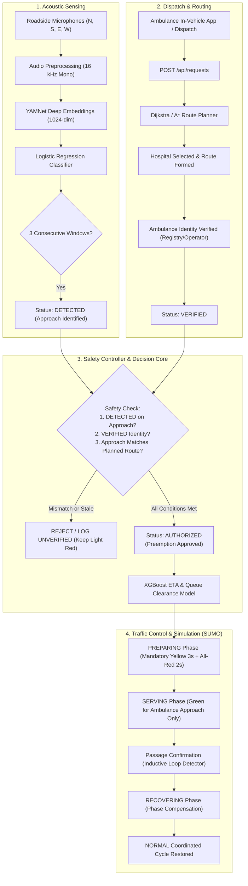
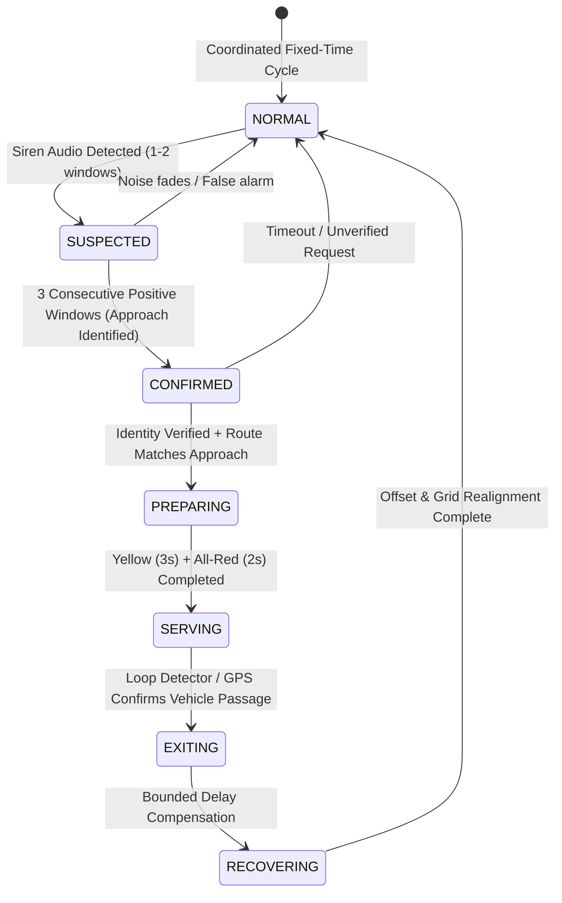
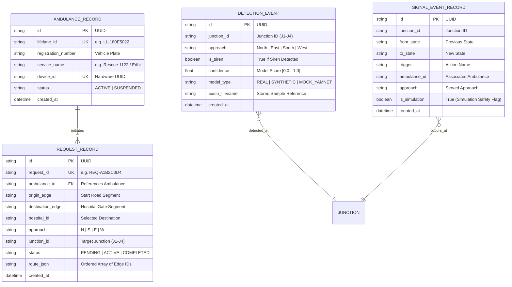

# LifeLane — Complete System Architecture & Operational Guide

> **Project Identity:** Route-Aware Smart Ambulance Traffic Signal Preemption with Coordinated Recovery  
> **Target Audience:** FYP Supervisors, Technical Evaluators, Emergency Services & Traffic Engineering Stakeholders  
> **Environment:** Simulation & Desktop Prototype (Safe Tabletop POC)

---

## Table of Contents
1. [Executive Summary (The Big Picture in Plain English)](#1-executive-summary)
2. [End-to-End Architecture Diagrams](#2-end-to-end-architecture-diagrams)
3. [Pillar 1: Machine Learning & Audio Intelligence](#3-pillar-1-machine-learning--audio-intelligence)
4. [Pillar 2: Dynamic Route Planning](#4-pillar-2-dynamic-route-planning)
5. [Pillar 3: The Three-Tier Verification & Safety Controller](#5-pillar-3-three-tier-verification--safety-controller)
6. [Pillar 4: Database Architecture & Data Models](#6-pillar-4-database-architecture--data-models)
7. [Pillar 5: Backend & Frontend Full-Stack Integration](#7-pillar-5-backend--frontend-full-stack-integration)
8. [End-to-End Walkthrough of an Incident (Story Mode)](#8-end-to-end-walkthrough-of-an-incident)
9. [FYP Presentation & Viva Defense Q&A](#9-fyp-presentation--viva-defense-qa)

---

## 1. Executive Summary

In cities like Karachi and Lahore, ambulances face severe delays trapped at congested intersections, while conventional "green corridors" require manual police intervention or blindly grant green lights, creating high risks of T-bone collisions.

**LifeLane solves this through a multi-modal, safety-first preemption system:**
1. **It hears sirens:** Roadside microphones analyze audio using Deep Learning (YAMNet embeddings + Classifier) to detect an approaching siren.
2. **It verifies identity:** Audio alone **never** turns a light green. The system confirms an authorized emergency request from a registered or temporary ambulance.
3. **It predicts arrival:** It calculates the optimal route to the destination hospital using Dijkstra/A* and predicts the exact junction arrival time using an **XGBoost ETA model**.
4. **It coordinates signals safely:** It transitions signals through mandatory yellow and all-red clearance intervals, gives the ambulance a green wave, confirms passage, and smoothly recovers normal grid synchronization.

---

## 2. End-to-End Architecture Diagrams

### A. High-Level System Workflow


### B. Signal State Machine Lifecycle


---

## 3. Pillar 1: Machine Learning & Audio Intelligence

The audio subsystem operates in `src/lifelane_engine/audio/` and `backend/services/inference.py`.

### 1. The Acoustic Pipeline
* **Input:** Raw audio recorded from directional microphones placed on four approaches: North, East, South, and West.
* **Preprocessing (`preprocess.py`):**
  * Resamples audio to **16,000 Hz (mono)**.
  * Segments audio into **0.96-second sliding windows** (15,360 audio samples per frame).
  * Validates audio integrity (removes NaNs/infinities).

### 2. Feature Extraction: Google YAMNet (`feature_extractor.py`)
* Instead of building an audio model from scratch with limited data, LifeLane uses **transfer learning** with **Google YAMNet** (pre-trained on 2M+ YouTube AudioSet clips).
* YAMNet's final classification layer is removed; its penultimate layer outputs a rich **1024-dimensional semantic embedding vector** per audio frame.
* *Graceful Fallback:* If TensorFlow is not installed, the engine seamlessly switches to `MockYAMNet`, generating deterministic pseudo-embeddings so the full application remains 100% testable.

### 3. Siren Classification (`siren_classifier.py`)
* **Algorithm:** L2-regularized **Logistic Regression** paired with a `StandardScaler`.
* **Output:** A calibrated probability score $P(\text{siren})$. If $P(\text{siren}) \ge \text{threshold}$ (default: $0.60$), the frame is tagged as positive.
* **Debouncing Filter (`approach_selector.py`):**
  * Prevents false alarms from horns or brief engine revving.
  * An approach is only promoted to `CONFIRMED / DETECTED` if **3 consecutive 0.96-second windows** produce positive siren predictions on that same approach.

### 4. ETA & Queue Prediction (`lifelane_engine/prediction/eta_model.py`)
* **Algorithm:** **XGBoost Regressor (`XGBRegressor`)**.
* **Features:** Current distance to junction, vehicle speed, approach queue length (vehicles/meters), current traffic light phase, and time of day.
* **Target:** Predicts the exact seconds until the ambulance reaches the junction stopline, allowing the controller to begin the 5-second yellow/all-red transition *just in time*.

---

## 4. Pillar 2: Dynamic Route Planning

Implemented in `src/lifelane_engine/ambulance/route_planner.py`.

### 1. Graph Model
* The road network is modeled as a directed graph $G = (V, E)$:
  * Vertices ($V$): Signalized intersections (J1, J2, J3, J4) and hospital entry points (H1).
  * Edges ($E$): Directed road segments with distance, speed limits, and lanes.

### 2. Routing Algorithm
* Implements **Dijkstra’s Algorithm** with an option for **A\*** (using Euclidean distance to the hospital as the heuristic).
* **Cost Function:**
  $$\text{Cost}(e) = \text{FreeFlowTime}(e) + \text{IntersectionDelay}(e) + \text{CongestionPenalty}(e)$$
* When an ambulance submits an emergency request, the route planner outputs an ordered sequence of edges and intersection approaches:
  $$\text{Corridor} = [(\text{Edge}_{1}, \text{J1}, \text{North}), (\text{Edge}_{2}, \text{J2}, \text{West}), (\text{Edge}_{3}, \text{H1}, \text{Destination})]$$

---

## 5. Pillar 3: Three-Tier Verification & Safety Controller

Located in `src/lifelane_engine/traffic/signal_controller.py` and `dispatch/`.

### The Core Safety Axiom
> **A siren prediction is supporting evidence ONLY. It must NEVER directly turn a traffic light green.**

To eliminate false preemption (e.g., sound trucks, YouTube videos, unauthorized sirens), LifeLane enforces a strict **Three-Tier Verification Ladder**:

```
Level 1: UNDETECTED  --> Normal grid timing.
   |
   +--> [Acoustic ML triggers 3 consecutive windows]
   v
Level 2: DETECTED    --> Approach identified. (CANNOT grant green).
   |
   +--> [Identity authenticated via Registry or Operator token]
   v
Level 3: VERIFIED    --> Emergency confirmed. (CANNOT grant green yet).
   |
   +--> [Safety Controller verifies: Approach == Planned Route Edge]
   v
Level 4: AUTHORIZED  --> Signal transition approved!
```

### Safety Guardrails (Non-Negotiable)
1. **No Conflicting Greens:** Conflicting movements can never receive simultaneous green indications under any condition.
2. **Mandatory Clearance Interval:** Any active green phase must transition through **3 seconds of Yellow** and **2 seconds of All-Red** before the ambulance green is illuminated.
3. **Passage Confirmation:** The green signal is terminated using **physical inductive loop detectors or GPS coordinates** — never by the absence of audio.
4. **Bounded Recovery:** After passage, delayed phases receive temporary split compensation, and grid synchronization is safely recovered without sudden cycle resets.

---

## 6. Pillar 4: Database Architecture & Data Models

Managed via **SQLAlchemy 2.0 (Async)** with **`aiosqlite`** in `backend/database.py` and `backend/models.py`. Stored in `lifelane.db`.



---

## 7. Pillar 5: Backend & Frontend Full-Stack Integration

### The Stack at a Glance
* **Backend:** FastAPI (Python 3.14) on `http://localhost:8000`
* **Frontend:** React 19 + Vite + Tailwind CSS on `http://localhost:5173`
* **Communication:** REST APIs via Axios with Vite server-side proxy (`/api` $\rightarrow$ `http://localhost:8000`)

### Primary API Endpoints
| HTTP Method | Route | Description |
| :--- | :--- | :--- |
| `GET` | `/api/health` | System health check (DB connectivity, inference engine status, version). |
| `GET` | `/api/model-info` | Returns active ML model metadata, classes, and synthetic warnings. |
| `POST` | `/api/detect` | Uploads raw audio file for siren detection on a specific junction approach. |
| `GET` | `/api/detections` | Returns paginated acoustic detection records. |
| `POST` | `/api/ambulances/register` | Registers a new emergency vehicle with system ID and credentials. |
| `GET` | `/api/ambulances` | Lists registered ambulances. |
| `POST` | `/api/requests` | Creates a new emergency corridor request with destination hospital. |
| `GET` | `/api/signals` | Returns real-time state of all 4 junctions (`NORMAL`, `SERVING`, etc.). |
| `POST` | `/api/signals/{j_id}/simulate` | Triggers a simulated action (`request_priority`, `confirm_passage`, `reset`). |
| `GET` | `/api/events` | Returns the recent audit trail of traffic light state transitions. |
| `GET` | `/api/stats` | Aggregated metrics for the frontend operational dashboard. |

---

## 8. End-to-End Walkthrough of an Incident

Imagine an emergency call in Karachi where an Edhi ambulance needs to transport a critical patient to Jinnah Postgraduate Medical Centre (JPMC):

1. **Dispatch:** The paramedic sets JPMC as the destination in the in-vehicle app. The app calls `POST /api/requests`.
2. **Pathfinding:** The Dijkstra route engine computes the corridor: the ambulance will travel down Main Boulevard, encountering Junction **J1 from the North**, then Junction **J2 from the West**.
3. **Acoustic Check:** As the vehicle approaches Junction J1, the North microphone captures siren audio. YAMNet generates 1024-dim embeddings; the classifier returns $P(\text{siren}) = 0.94$. Three consecutive positive windows mark the approach as `DETECTED`.
4. **Safety Arbitration:** The Safety Controller receives the audio notification. It verifies:
   * Is vehicle `LL-DEMO-001` an authorized active ambulance? $\rightarrow$ **Yes.**
   * Does its registered route approach Junction J1 from the North? $\rightarrow$ **Yes.**
   * Status advances from `VERIFIED` to **`AUTHORIZED`**.
5. **Preemption Execution:**
   * Junction J1 signals transition to `PREPARING`: active East-West green turns **Yellow (3s)**, followed by **All-Red (2s)**.
   * North approach turns **Green (`SERVING`)**. The ambulance drives through unimpeded.
6. **Passage & Recovery:**
   * An exit loop detector fires as the ambulance clears the intersection.
   * J1 transitions to `RECOVERING`. The controller allocates bonus green time to the East-West traffic that was held at red, restoring coordinated grid progression.
7. **Audit:** Every decision, timestamp, confidence score, and light transition is stored in SQLite for auditing.

---

## 9. FYP Presentation & Viva Defense Q&A

### Q1: Why didn't you let the siren sound directly turn the light green?
> **Answer:** *"Allowing audio alone to trigger preemption is a critical safety vulnerability. A loud speaker playing a siren sound, noise pollution, or an ambulance traveling on a cross street could cause false triggers and catastrophic collisions. In LifeLane, audio is supporting physical evidence that is strictly cross-referenced against verified dispatch records and planned route directions."*

### Q2: What happens if an unregistered ambulance (e.g., private vehicle or rural service) needs preemption?
> **Answer:** *"LifeLane includes a Temporary Verification Pathway. A dispatch operator can issue a time-limited incident token, or the operator can verify the vehicle via a license plate check without requiring permanent pre-registration."*

### Q3: Why did you use YAMNet instead of training a CNN from scratch on raw audio?
> **Answer:** *"Emergency siren datasets are relatively small. Training deep convolutional networks from scratch on limited data leads to overfitting on background noise. Google's YAMNet is trained on AudioSet (over 2 million clips), giving us rich, noise-robust acoustic feature representations that allow a lightweight Logistic Regression classifier to achieve high accuracy with minimal CPU overhead."*

### Q4: Why use SQLite in development instead of full PostgreSQL?
> **Answer:** *"SQLite allows the entire simulation to be evaluated on any standard laptop without external database server overhead or credential setup. Because we built the persistence layer using asynchronous SQLAlchemy 2.0, switching to enterprise PostgreSQL requires changing only the `DATABASE_URL` connection string in the configuration."*
